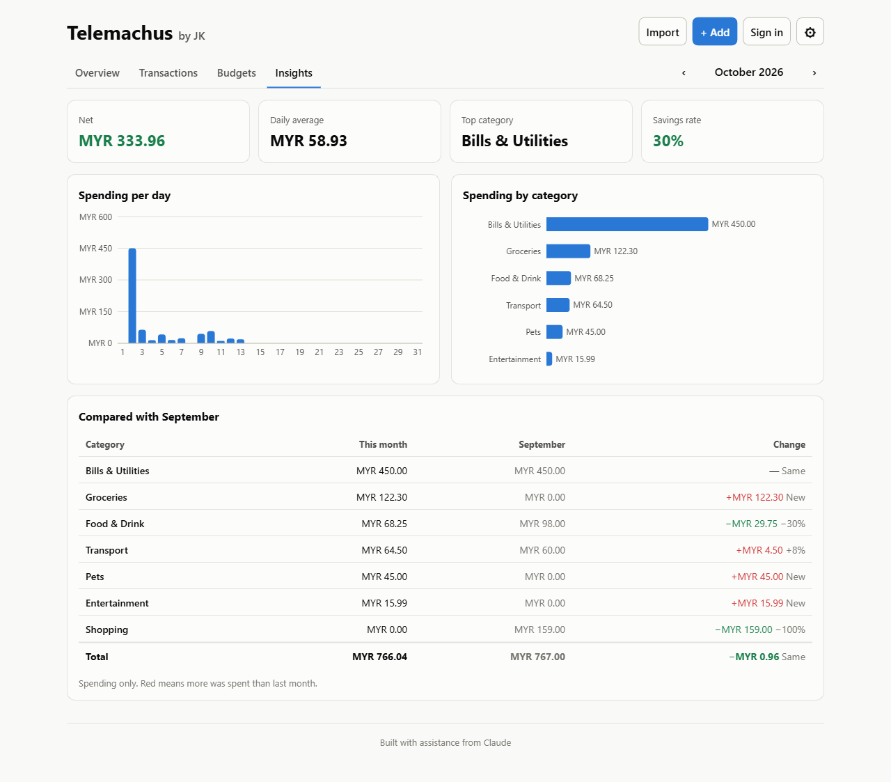

# Telemachus by JK

A web app for logging daily income and spending, tracking your balance, and seeing where your money goes, by day and by category.

**Live demo:** https://ngjyekang11.github.io/Telemachus/




Built with assistance from [Claude](https://claude.com/claude-code).

## Features

- **Four simple pages:** Overview (balance, spending, income and recent transactions), Transactions, Budgets and Insights (charts), with a month switcher shared by all of them
- **Settings (⚙):** account and sync, currency, your own categories, backups, and resetting everything, all in one place
- **Add, edit and delete transactions** with an amount, category, date and an optional note, in a pop-up. Deleting happens straight away with an **Undo** bar instead of "Are you sure?"
- **Change many at once:** on the Transactions page, tick several and move them to a category or delete them together
- **Income and spending:** switch between Expense and Income when adding a transaction, each with its own categories
- **Your own categories:** add spending or income categories (like "Pets" or "Allowance"); spending ones can have a budget
- **Running balance:** every day shows its net amount and the balance at the end of that day
- **Every month:** an allowance, salary, rent or subscription is added automatically on its day each month (on the last day in shorter months), catching up on any months the app wasn't opened
- **Adjust balance:** remove or add an amount, or set the exact balance, for money that moved without being logged (like paying through another app). It's saved as an "Adjustment"
- **Import a bank statement (CSV or PDF):** pick the file you downloaded from online banking and the app finds the date, description and amount columns, guesses a category for each row, skips ones you already added, and lets you review everything before saving. The file is read in your browser and never uploaded. PDF reading is best-effort (layouts vary between banks and scanned PDFs can't be read), so the preview asks you to check each row and lets you swap any row between money in and money out. Categories you change in the preview are **remembered** for the same merchant or person next time. There are sample statements to try: [CSV](public/sample-statement.csv) and [PDF](public/sample-statement.pdf)
- **Daily view:** transactions are grouped by day, newest first
- **Monthly summary:** balance, income, spending, net, daily average, top category and savings rate
- **Monthly budgets:** set a limit for each spending category and see a progress bar for the month, with a warning at 80% and when you go over
- **Charts:** spending per day and spending by category (with hover tooltips), plus a table comparing each category with last month
- **Filters:** see all time or one month, filter by category, or search your notes
- **Currency picker** (USD, EUR, MYR, SGD and more)
- **Saves automatically** in your browser, so there's no account or server needed
- **Backup and export:** download everything as a backup file and restore it later (or in another browser), or export transactions as CSV for a spreadsheet
- **Reset everything:** a kill switch in Settings that deletes all data and resets the currency (and the signed-in account's copy). It lists what will go, offers a backup first, only works after typing RESET, and can be undone for 10 seconds
- **Optional Google sign-in:** sign in to keep your data in your Google account and use it on any device. Changes sync automatically, and signing out removes the data from that device (see [Google sign-in setup](#google-sign-in-setup))
- **Light and dark mode** (follows your system setting) and a layout that works on phones

## Tech stack

| Area | Tools |
| --- | --- |
| UI | [React 19](https://react.dev) + [TypeScript](https://www.typescriptlang.org) |
| Build tool | [Vite](https://vite.dev) |
| Charts | [Recharts](https://recharts.org) |
| PDF reading | [pdf.js](https://mozilla.github.io/pdf.js/) (loaded only when a PDF is chosen) |
| Sign-in and sync | [Firebase](https://firebase.google.com) Authentication (Google) + Cloud Firestore (optional, loaded only when set up) |
| Tests | [Vitest](https://vitest.dev) |
| Linting | [oxlint](https://oxc.rs) |
| CI / hosting | GitHub Actions → GitHub Pages |

## Getting started

You need [Node.js](https://nodejs.org) 20 or newer.

```bash
git clone https://github.com/NgJyeKang11/Telemachus.git
cd Telemachus
npm install
npm run dev
```

Then open the link Vite prints (usually http://localhost:5173/).

| Command | What it does |
| --- | --- |
| `npm run dev` | Start the dev server with hot reload |
| `npm test` | Run the unit tests |
| `npm run lint` | Check the code for common mistakes |
| `npm run build` | Type-check and build the production site into `dist/` |
| `npm run preview` | Serve the production build locally |

## Project structure

```
src/
├── App.tsx                  # Header, page tabs, filters and app state
├── types.ts                 # Transaction type and category list
├── components/
│   ├── ImportDialog.tsx     # CSV / PDF statement import with column mapping and a preview
│   ├── TransactionDialog.tsx # Pop-up holding the add / edit form
│   ├── TransactionForm.tsx  # Add / edit form with validation
│   ├── TransactionList.tsx  # Transactions grouped by day
│   ├── RecentTransactions.tsx # The latest few transactions on the Overview page
│   ├── MonthPicker.tsx      # Previous / next month switcher
│   ├── SummaryCards.tsx     # Balance / income / spent / net / average / savings rate
│   ├── BudgetPanel.tsx      # Set a limit per category, with progress bars
│   ├── BudgetAlerts.tsx     # Banner for categories that are over or near their budget
│   ├── RecurringPanel.tsx   # "Every month" card: allowance, rent, subscriptions
│   ├── AdjustBalanceDialog.tsx # Remove / add an amount, or set the exact balance
│   ├── AccountMenu.tsx      # "Sign in with Google", or the signed-in account's menu
│   ├── CategoriesPanel.tsx  # "Your categories": add or remove your own
│   ├── BulkBar.tsx          # Change the category of, or delete, several transactions
│   ├── UndoToast.tsx        # The "Deleted … Undo" bar
│   ├── MonthComparison.tsx  # Spending per category vs last month
│   ├── SettingsPage.tsx     # Account, currency, your categories, backups, danger zone
│   ├── DataMenu.tsx         # Download / restore a backup, export CSV
│   ├── ResetDialog.tsx      # The "Reset everything?" warning, unlocked by typing RESET
│   └── SpendingCharts.tsx   # Daily and per-category bar charts
├── hooks/
│   ├── useTransactions.ts   # State + automatic saving to localStorage
│   ├── useBudgets.ts        # Budgets + automatic saving to localStorage
│   ├── useRecurring.ts      # Recurring items + automatic saving to localStorage
│   ├── useStoredState.ts    # State that's saved to localStorage whenever it changes
│   ├── useCategories.ts     # Shares your own categories with every category picker
│   ├── useAccountActions.ts # Sign-in / sign-out button behaviour, shared by the header and Settings
│   └── useCloudSync.ts      # Keeps the data in step with the signed-in Google account
└── lib/                     # Plain functions with unit tests
    ├── csv.ts               # CSV parsing, date/amount reading, column guessing, duplicate check
    ├── pdf.ts               # Reads a PDF with pdf.js and returns its text with positions
    ├── pdfRows.ts           # Rebuilds a transaction table from positioned PDF text
    ├── categorize.ts        # Guesses a category from a statement description, and remembers your picks
    ├── money.ts             # Parsing and formatting amounts
    ├── dates.ts             # Local-date helpers
    ├── recurring.ts         # Works out which monthly items are due and adds them
    ├── stats.ts             # Totals, net, running balance, grouping, per-day and per-category sums, budget status
    ├── storage.ts           # Loading/saving with validation
    ├── sync.ts              # Checking account data and merging a device into an account
    ├── backup.ts            # Backup files and CSV export
    ├── cloud.ts             # Firebase sign-in and Firestore reads/writes (loaded on demand)
    └── firebaseConfig.ts    # The Firebase project's web settings (null = sign-in hidden)
firestore.rules              # Who can read and write what in Firestore
```

## Design decisions

- **Money is stored in cents (integers).** Floating-point maths gets money wrong (`0.1 + 0.2 !== 0.3`), so `"12.50"` is saved as `1250`.
- **Dates are local `YYYY-MM-DD` strings.** This avoids the classic bug where a transaction shows up on the wrong day because of time zones.
- **A budget only counts as "over" once spending is above the limit.** Spending exactly at the limit, or from 80% up, shows a "close to the limit" warning instead.
- **Imports show a preview and never drop rows silently.** Anything that can't be read is listed with the reason, and likely duplicates are unticked so re-importing an overlapping statement doesn't double-count.
- **Logic lives in `src/lib`, separate from the UI.** Calculations are plain functions, which makes them easy to unit test.
- **Monthly items are added once, at start-up.** Each one remembers the last month it was added for, and the app adds anything due before it shows any data, so a month is never added twice and deleting one doesn't bring it back.
- **Saved data is validated when it's loaded.** Corrupted or hand-edited localStorage entries are skipped instead of crashing the app. Data from a signed-in account goes through the same checks.
- **Sign-in never loses data.** The first time a device signs in, its data is merged into the account. After that, the account's copy wins when the app opens, so something deleted on one device doesn't come back from another. Monthly items get an id made from the item and the month, so two devices adding the same month don't create a duplicate.

## Deployment

Every push to `main` runs the lint, tests and build in GitHub Actions, then publishes the site to GitHub Pages. To turn it on for your own copy: **Settings → Pages → Source: GitHub Actions**.

## Google sign-in setup

Sign-in is optional and stays hidden until a Firebase project is connected. The free Spark plan is enough.

1. Create a project at [console.firebase.google.com](https://console.firebase.google.com) (Google Analytics isn't needed).
2. **Authentication → Get started → Sign-in method → Google → Enable**, pick a support email, and save.
3. **Authentication → Settings → Authorized domains → Add domain:** your GitHub Pages domain (for example `ngjyekang11.github.io`). `localhost` is there already for development.
4. **Firestore Database → Create database** (production mode, any nearby location), then open **Rules**, replace them with the contents of [`firestore.rules`](firestore.rules), and **Publish**.
5. **Project settings → Your apps → Web (`</>`)**, register an app, and copy the `firebaseConfig` object into [`src/lib/firebaseConfig.ts`](src/lib/firebaseConfig.ts) in place of `null`.

The config values aren't secrets: each person's data is protected by Google sign-in and the Firestore rules, which only let a signed-in person read and write their own document.

## Roadmap

- [x] Income tracking and a running balance
- [x] Monthly budgets per category, with warnings when you go over
- [x] Import a bank statement from CSV
- [x] Export your data as CSV, and back up / restore everything
- [x] Your own categories, remembered import categories, undo, bulk edits and month-to-month comparison
- [ ] Separate accounts (bank, e-wallet) with their own balances
- [ ] Install on a phone as an app that works offline
- [x] Import PDF statements (best-effort; scanned PDFs would need OCR)
- [x] Google sign-in with cloud sync (Firebase)
- [x] Recurring transactions (allowance, rent, subscriptions)
- [x] Adjust the balance for money moved outside the app
