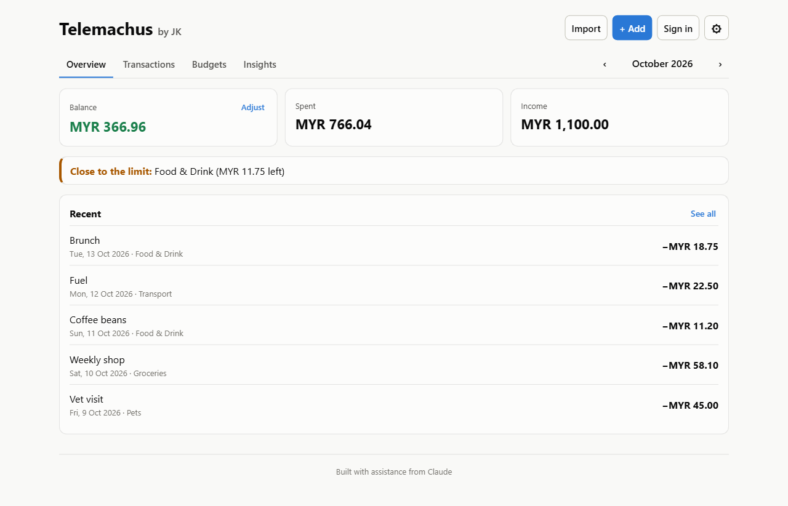

# Spending Tracker

A web app for logging daily income and spending, tracking your balance, and seeing where your money goes, by day and by category.

**Live demo:** https://ngjyekang11.github.io/FInancial-Tracking-System/



## Features

- **Add, edit and delete transactions** with an amount, category, date and an optional note
- **Income and spending:** switch between Expense and Income when adding a transaction, each with its own categories
- **Running balance:** every day shows its net amount and the balance at the end of that day
- **Daily view:** transactions are grouped by day, newest first
- **Monthly summary:** balance, income, spending, net, daily average, top category and savings rate
- **Monthly budgets:** set a limit for each spending category and see a progress bar for the month, with a warning at 80% and when you go over
- **Charts:** spending per day and spending by category (with hover tooltips)
- **Filters:** pick a month, filter by category, or search your notes
- **Currency picker** (USD, EUR, MYR, SGD and more)
- **Saves automatically** in your browser, so there's no account or server needed
- **Light and dark mode** (follows your system setting) and a layout that works on phones

## Tech stack

| Area | Tools |
| --- | --- |
| UI | [React 19](https://react.dev) + [TypeScript](https://www.typescriptlang.org) |
| Build tool | [Vite](https://vite.dev) |
| Charts | [Recharts](https://recharts.org) |
| Tests | [Vitest](https://vitest.dev) |
| Linting | [oxlint](https://oxc.rs) |
| CI / hosting | GitHub Actions → GitHub Pages |

## Getting started

You need [Node.js](https://nodejs.org) 20 or newer.

```bash
git clone https://github.com/NgJyeKang11/FInancial-Tracking-System.git
cd FInancial-Tracking-System
npm install
npm run dev
```

Then open the link Vite prints (usually http://localhost:5173/FInancial-Tracking-System/).

| Command | What it does |
| --- | --- |
| `npm run dev` | Start the dev server with hot reload |
| `npm test` | Run the unit tests |
| `npm run lint` | Check the code for common mistakes |
| `npm run build` | Type-check and build the production site into `dist/` |
| `npm run preview` | Serve the production build locally |

## Project structure

```
src/
├── App.tsx                  # Page layout, filters and app state
├── types.ts                 # Transaction type and category list
├── components/
│   ├── TransactionForm.tsx  # Add / edit form with validation
│   ├── TransactionList.tsx  # Transactions grouped by day
│   ├── SummaryCards.tsx     # Balance / income / spent / net / average / savings rate
│   ├── BudgetPanel.tsx      # Set a limit per category, with progress bars
│   ├── BudgetAlerts.tsx     # Banner for categories that are over or near their budget
│   └── SpendingCharts.tsx   # Daily and per-category bar charts
├── hooks/
│   ├── useTransactions.ts   # State + automatic saving to localStorage
│   └── useBudgets.ts        # Budgets + automatic saving to localStorage
└── lib/                     # Plain functions with unit tests
    ├── money.ts             # Parsing and formatting amounts
    ├── dates.ts             # Local-date helpers
    ├── stats.ts             # Totals, net, running balance, grouping, per-day and per-category sums, budget status
    └── storage.ts           # Loading/saving with validation
```

## Design decisions

- **Money is stored in cents (integers).** Floating-point maths gets money wrong (`0.1 + 0.2 !== 0.3`), so `"12.50"` is saved as `1250`.
- **Dates are local `YYYY-MM-DD` strings.** This avoids the classic bug where a transaction shows up on the wrong day because of time zones.
- **A budget only counts as "over" once spending is above the limit.** Spending exactly at the limit, or from 80% up, shows a "close to the limit" warning instead.
- **Logic lives in `src/lib`, separate from the UI.** Calculations are plain functions, which makes them easy to unit test.
- **Saved data is validated when it's loaded.** Corrupted or hand-edited localStorage entries are skipped instead of crashing the app.

## Deployment

Every push to `main` runs the lint, tests and build in GitHub Actions, then publishes the site to GitHub Pages. To turn it on for your own copy: **Settings → Pages → Source: GitHub Actions**.

## Roadmap

- [x] Income tracking and a running balance
- [x] Monthly budgets per category, with warnings when you go over
- [ ] Import and export as CSV
- [ ] Cloud sync and user accounts (e.g. with Supabase)
- [ ] Recurring transactions (rent, subscriptions)
